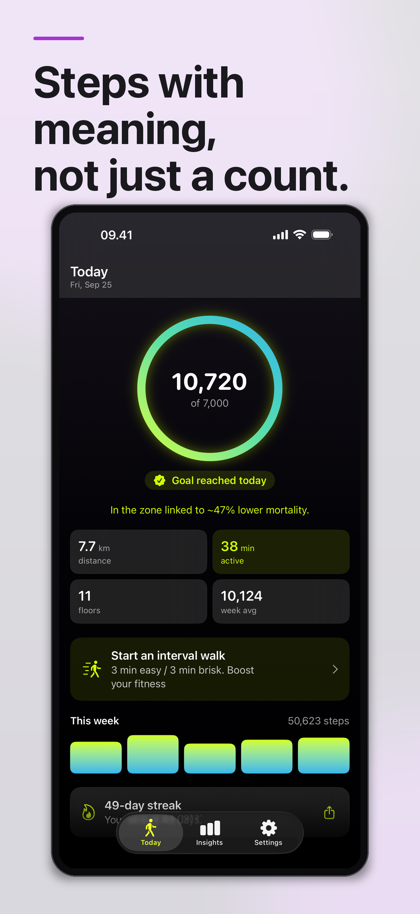
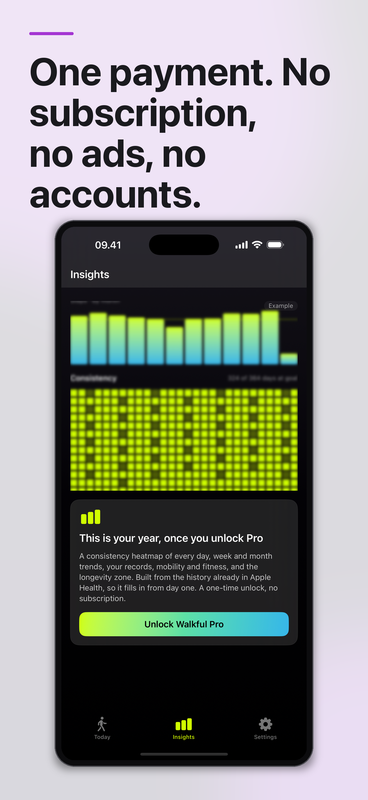

<picture>
  <source media="(prefers-color-scheme: dark)" srcset="app-icon-dark.png">
  
</picture>

# Walkful

Calm, private step tracker

<!-- IAMJARL README store block for Walkful (en). Generated from apps.json, v1.34.0. Do not edit. -->
<p>
  <a href="https://apps.apple.com/app/id6781303837?pt=128512007&amp;ct=github&amp;mt=8"><picture>
    <source media="(prefers-color-scheme: dark)" srcset="https://raw.githubusercontent.com/JarlLyng/iamjarl-design/v1.34.0/badges/app-store-white-en-us.svg">
    
  </picture></a>
  <br>
  Free · iOS 18 or later · <a href="https://walkful.iamjarl.com">walkful.iamjarl.com</a>
</p>

<p>
  
  
</p>

Every step counts. Walkful reads the steps your iPhone and Apple Watch already record in Apple Health, and shows what the day's walking does for your health, measured against about 7,000 steps rather than the 10,000 myth. It's for anyone who wants to walk a little more at their own pace, with no leaderboards and no pressure. The app is free, widgets and gentle move reminders included, and Walkful Pro is a one-time unlock with no subscription that adds Insights, the interval-walking coach and CSV export. Your health data stays on your iPhone: there's no account, no server and no ads, and the App Store privacy label reads Data Not Collected.

## For developers

<p>
  <a href="https://madebyhuman.iamjarl.com"><picture>
    <source media="(prefers-color-scheme: dark)" srcset="https://madebyhuman.iamjarl.com/badges/co-created-white.svg">
    </picture></a>
  <a href="https://github.com/JarlLyng/walkful/actions/workflows/ci.yml"></a>
  <a href="LICENSE"></a>
</p>

The developer half: what's in the app, how to build and run it, how it is put together, how to contribute, and the license.

### What's in it

- **Today:** a progress ring with a line on what the day's steps mean, distance, active minutes, floors, this week's bars and a streak card.
- **Insights (Pro):** week, month and year trends, a full-year consistency heatmap, mobility and fitness, records, a monthly recap and a longevity-zone card.
- **Interval-walking coach (Pro):** guided easy and brisk sessions with haptics.
- **Widgets:** Home Screen (small, and a medium "This week") and Lock Screen.
- **Gentle nudges:** local reminders when you've been sitting a while, within the hours you choose.
- **Sharing and export:** a progress card rendered on the device, and CSV export with Pro.
- **English and Danish,** with Dynamic Type, VoiceOver and Reduce Motion support.

What's next is tracked in [GitHub Issues](https://github.com/JarlLyng/walkful/issues).

### Build and run

Prerequisites: **Xcode 26+** and **XcodeGen** (`brew install xcodegen`).

```bash
# 1. Generate the Xcode project (it is git-ignored; project.yml is the source of truth)
xcodegen generate

# 2. Open and run
open Walkful.xcodeproj
#    (select an iPhone simulator or device, then Run)

# …or build from the command line:
xcodebuild -project Walkful.xcodeproj -scheme Walkful \
  -destination 'generic/platform=iOS Simulator' build
```

The `.xcodeproj` is **generated** and git-ignored. Never edit it by hand: change `project.yml` and re-run `xcodegen generate`. Tests are the `WalkfulTests` target, run through the `Walkful` scheme. See [CONTRIBUTING.md](CONTRIBUTING.md).

### Architecture

How the code is organised and how data flows is in [ARCHITECTURE.md](ARCHITECTURE.md).

**Principles:**

- **Meaning over numbers.** Progress is paired with what it means for your health, grounded in research (2025 Lancet Public Health; Bente Klarlund Pedersen), not the 10,000-steps myth.
- **Private by architecture.** All data is read from Apple Health and processed on the device. HealthKit access is read-only, and there is **no backend**, by design.
- **Calm, no manipulation.** No pace-shaming, no social leaderboards, no dark patterns. You compete against your own records.

#### Tech stack

| | |
|---|---|
| Language / UI | Swift 5 (language mode), SwiftUI |
| Min OS | iOS 18 |
| Health data | HealthKit (read-only) |
| Local storage | SwiftData |
| Notifications | UserNotifications (local only) |
| Background | BackgroundTasks (sedentary check) + App Group (widget sharing) |
| Widgets | WidgetKit (Home Screen + Lock Screen) |
| Monetization | StoreKit 2, one-time non-consumable ("Walkful Pro") |
| Diagnostics | MetricKit (Apple-native, no third-party SDK) |
| Design system | [IAMJARLDesignTokens](https://github.com/JarlLyng/iamjarl-design) via SPM |
| Project generation | [XcodeGen](https://github.com/yonaskolb/XcodeGen) (`project.yml`) |

#### Project structure

```
walkful/
├─ project.yml              # XcodeGen project definition (source of truth)
├─ Walkful.storekit         # Local StoreKit config (testing only)
├─ Walkful/                 # App source
│  ├─ WalkfulApp.swift      # @main, SwiftData container, MetricKit, BG task register
│  ├─ RootView.swift        # RootContainer (routing) + RootView (tabs)
│  ├─ Core/
│  │  ├─ Health/            # HealthKitService
│  │  ├─ Persistence/       # AppSettings (@Model)
│  │  ├─ Notifications/     # NudgeScheduler + SedentaryMonitor (BackgroundTasks)
│  │  ├─ Store/             # Store (StoreKit 2, Walkful Pro)
│  │  ├─ Shared/            # SharedStore (App Group snapshot for the widget)
│  │  ├─ Diagnostics/       # MetricsSubscriber (MetricKit)
│  │  ├─ Theme/             # WalkfulTheme (IAMJARL tokens) + Components
│  │  └─ Formatters.swift
│  ├─ Features/             # Onboarding / Today / Insights / Coach / Paywall / Settings / Share
│  └─ Resources/            # Assets.xcassets (layered app icon)
├─ WalkfulWidget/           # WidgetKit extension (Home + Lock Screen)
├─ Tests/                   # WalkfulTests unit tests (run via the Walkful scheme)
├─ appstore/                # App Store posters: raw captures, manifest, composed sets
├─ website/                 # Marketing site (static, SEO/GEO)
├─ docs/                    # Process docs (roadmap, release guide, device checklist)
├─ docs/history/            # Superseded pre-launch specs (Danish, June 2026)
├─ ci_scripts/              # Xcode Cloud post-clone (xcodegen + SwiftPM resolve)
├─ .github/                 # CI workflow, Pages deploy, issue/PR templates
└─ ARCHITECTURE.md CONTRIBUTING.md CHANGELOG.md   # Developer docs (English)
```

Generated and git-ignored: `Walkful.xcodeproj`, `Walkful/Info.plist`, `WalkfulWidget/Info.plist`. Run `xcodegen generate` after pulling.

#### Documentation

- **[ARCHITECTURE.md](ARCHITECTURE.md):** how the code is organised and how data flows.
- **[CONTRIBUTING.md](CONTRIBUTING.md):** setup, conventions, workflow, release.
- **[docs/ROADMAP.md](docs/ROADMAP.md):** project status, how work is tracked, and where to start (handoff).
- **[docs/app-store-release.md](docs/app-store-release.md):** App Store listing copy and the submit checklist.
- **[docs/device-checklist.md](docs/device-checklist.md):** what to verify on a physical iPhone or Watch, the things the simulator can't show.
- **[appstore/README.md](appstore/README.md):** how the App Store posters are captured and composed.
- **[CHANGELOG.md](CHANGELOG.md):** notable changes.
- **[AGENTS.md](AGENTS.md):** quick-start context for developers and coding agents, whichever you use.
- **[docs/history/](docs/history/):** the pre-launch product and technical specs (Danish, June 2026). Kept for context; they describe what was planned, not what shipped.
- **[website/](website/):** the marketing site and the privacy policy.

### Privacy

Walkful collects nothing. Health data is read from Apple Health with explicit, granular permission, used only on the device, and never transmitted. See [website/privacy.html](website/privacy.html).

### Contributing

Read [CONTRIBUTING.md](CONTRIBUTING.md) first. Bugs, feature requests and tasks are [GitHub Issues](https://github.com/JarlLyng/walkful/issues) on this repo, and the [Code of Conduct](CODE_OF_CONDUCT.md) applies. Found a vulnerability? Report it privately through [SECURITY.md](SECURITY.md) rather than in a public issue.

### License

[AGPL-3.0](LICENSE). Walkful is made by Jarl at [IAMJARL](https://iamjarl.com).
